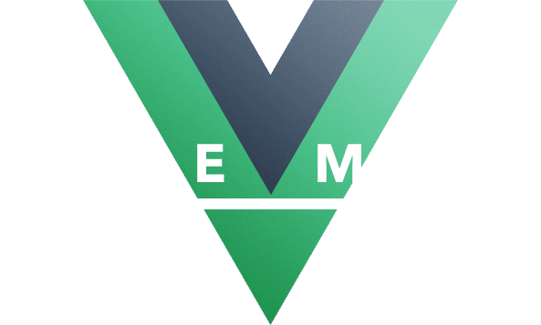
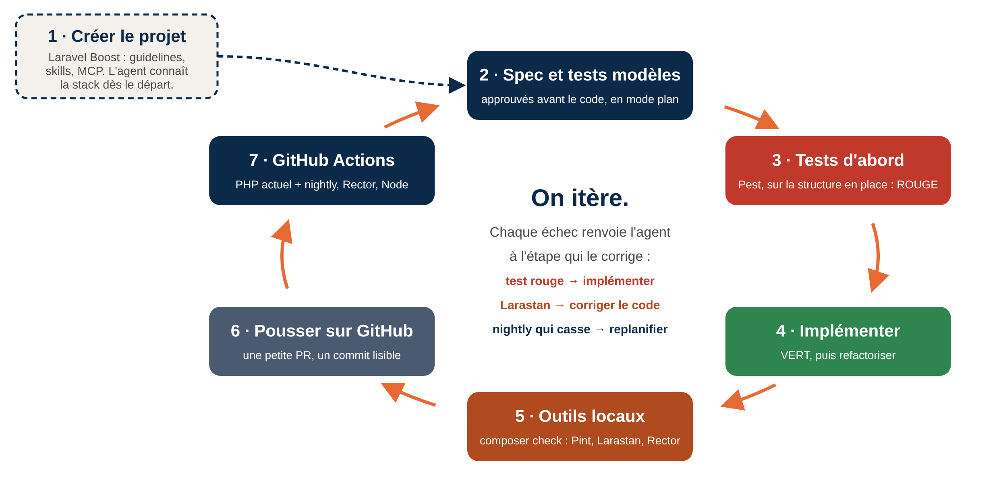

<!-- _class: lead -->
<!-- _paginate: false -->
<!-- _footer: "" -->

# Développement assisté par agent

## Coder sans perdre le fil

Un guide basé sur huit mois de travail quotidien avec un agent, en PHP (Laravel) et Vue.js

Inspiré de la série « Exploring Generative AI » publiée sur martinfowler.com et de la présentation « Quand l'IA accélère tout… sauf la compréhension » de Massimo Russo (Vue Montréal 2026)

**Alexi Tessier** · AET Code

<div class="cover-logos">



</div>


---

## À propos de moi

<div class="columns">

<div class="column">

### Alexi Tessier, développeur web

Développeur web depuis près de 10 ans, présentement en poste permanent chez AET Code.

J'ai conçu des API et modernisé des systèmes pour les secteurs bancaire, médiatique, publicitaire et automobile, en .NET comme en PHP.

Depuis mars, je travaille au quotidien avec des agents de code. Je viens partager ce qui fonctionne vraiment, et ce qui accroche.

</div>
<div class="column">

### AET Code

Une division d'AET Solutions, à Montréal. Au quotidien, des contrats web pour des entreprises, le soutien d'applications existantes et leur migration vers des systèmes plus modernes.

</div>

</div>


---

## Au programme

1. **Deux portraits de l'agent** : l'âne et le miroir
2. **Mes usages au quotidien** : comprendre, revoir, entretenir
3. **Le cadre** : contexte, spec approuvé, tests, garde-fous d'équipe
4. **Démo** : une vraie application Laravel + Vue, du premier prompt à 259 tests
5. **Les trois illusions** : les mauvaises habitudes qui s'installent vite
6. **Le contrepoint** : pourquoi c'est aussi un piège, ce que ça coûte à l'expertise, et quoi retenir


---

## Deux portraits à garder en tête

<div class="columns">

<div class="column">

### L'âne (Birgitta Böckeler, martinfowler.com, 2023)

Le personnage qu'elle propose pour l'assistant : « pressé d'aider, têtu, très cultivé mais inexpérimenté, et qui n'admet pas quand il ne “sait” pas ».

Dans 40 à 60 % des cas, il te mène de 40 à 80 % du chemin.

Mais parfois il s'égare : il invente des choses, recode un composant qui existe déjà, bâtit une version compliquée dont personne n'avait besoin. Plus la session est longue, plus c'est aléatoire.

**Leçon : monte sur l'âne, mais ne t'endors pas dessus. C'est toi qui tiens les rênes.**

</div>
<div class="column">

### Le miroir (Massimo Russo, Vue Montréal 2026)

L'IA, c'est un ampli de guitare : elle ne joue pas mieux à ta place, elle joue plus fort. Tes bonnes notes comme tes fausses notes.

- Équipe claire, specs claires → l'IA amplifie la clarté.
- Équipe floue, aucune règle → l'IA amplifie le chaos, plus vite que jamais.

</div>

</div>


---

## Au quotidien, l'IA accélère mon travail

<div class="columns">

<div class="column">

### Comprendre

- **Cartographier une application existante** : des semaines → un après-midi pour trouver où vit une fonctionnalité, et comment la modifier pour corriger un bogue.
- **Revoir du code** : nos projets sont en silo. L'agent suit le parcours complet d'un changement à travers l'application, et me donne le contexte pour juger la PR.
- **Prototyper** : trois options pour un client, au lieu d'une seule.

</div>
<div class="column">

### Entretenir

- **Mettre à jour npm et Composer** : il lit les changelogs et le diff du code, puis trouve nos usages qui ont changé.
- **Mettre en place le CI** : linters et mises à niveau dans GitHub Actions. Je connais le résultat voulu ; je n'ai pas besoin d'être expert en Docker ni en GitHub Actions.

</div>

</div>


---

## Pourquoi un framework fullstack aide l'agent

<div class="columns">

<div class="column">

### Toute la stack, d'un seul coup

Laravel + Inertia + Vue, dans un seul dépôt : l'agent voit tout le chemin d'une fonctionnalité, de la route au contrôleur, au modèle, jusqu'à la page Vue.

- Pas d'API séparée à documenter, pas de contrat à deviner entre deux équipes.
- Boost connaît les versions de chaque couche.
- Un seul test Pest vérifie la requête, les données et la page Inertia envoyée.

</div>
<div class="column">

### Un design modulaire, imposé

Le framework a une place pour chaque chose : modèles, *Form Requests*, services, composants Vue, pages.

- L'agent suit les conventions au lieu d'inventer une structure.
- Des petits morceaux, c'est des petits prompts, des petits tests et des diffs qu'on relit.
- Le prochain prompt réutilise ce qui existe déjà : le même formulaire, la même modale.

</div>

</div>


---

## Les skills : des réflexes pour l'agent

<div class="columns">

<div class="column">

### Ponytail : le dev senior paresseux

« The best code is the code you never wrote. » Réutiliser l'existant, la librairie standard et la plateforme avant d'écrire du neuf, sans jamais couper la validation, la sécurité ni l'accessibilité.

- `/ponytail lite | full | ultra` : l'intensité
- `/ponytail-review` : revue du diff (bogues, sécurité, code de trop)
- `/ponytail-audit` : la même revue sur tout le dépôt

L'antidote à l'âne qui réinvente la roue.

</div>
<div class="column">

### Everything Claude Code (ECC) : la boucle de revue

- `tdd-workflow` et `laravel-tdd` : rouge, vert, refactoriser
- Agent `code-reviewer` : relit le diff avec un contexte neuf
- `/code-review` : bloque le commit s'il trouve un problème CRITICAL ou HIGH
- `verification-loop` : build, types, lint, tests et couverture, sécurité, diff, puis un rapport PASS / FAIL

Ma boucle : implémenter → revue → corriger → vérifier, et on recommence jusqu'au PASS.

</div>

</div>


---

## Un spec précis, approuvé avant le code

<div class="columns">

<div class="column">

### Du vague au précis

> « Ajoute un filtre par statut. »

L'agent devine. Peut-être pas la bonne chose.

> « Un filtre par statut : Available, On hold, Sold. Combiné avec la recherche, gardé dans l'URL. Par défaut, tous les statuts ; un statut inconnu est ignoré. »

**Analysé et approuvé par le lead ou le PO avant la première ligne de code.**

</div>
<div class="column">

### Montrer l'exemple

J'écris moi-même deux ou trois tests : la structure, les noms, les factories. L'agent écrit les autres dans le même moule.

```php
it('lists every car when the status filter is unknown', function () {
    Car::factory()->create();
    Car::factory()->sold()->create();

    $this->actingAs(User::factory()->create())
        ->get(route('cars.index', ['status' => 'stolen']))
        ->assertInertia(fn (Assert $page) => $page->has('cars.data', 2));
});
```

</div>

</div>


---

<!-- _class: tdd -->

## Les tests, ton filet de sécurité

Faire écrire les tests par un agent rend le TDD/BDD plus efficace. Mes quelques tests modèles font partie du spec ; l'agent écrit les autres et les cas limites, que je relis et peaufine.

1. **ROUGE**\
   Écris le test d'abord, nommé en *Given-When-Then*, ça guide l'assistant. Vérifie qu'il échoue pour la bonne raison.
2. **VERT**\
   Laisse l'agent écrire juste assez de code pour que le test passe. Attention, il a tendance à faire de grands pas plutôt que des petits.
3. **REFACTORISER**\
   Fais le ménage. Le test passe encore, tu dors sur tes deux oreilles.

D'après Paul Sobocinski, « TDD with GitHub Copilot » (martinfowler.com, août 2023), qui conclut : on recommande d'utiliser l'assistant *avec* le TDD.

Laravel vient avec PHPUnit ; Pest et Vitest s'ajoutent chacun en une commande. Dans la démo : 259 tests Pest et 52 tests Vitest.

---

## Des garde-fous avant même la revue

<div class="columns">

<div class="column">

### Automatiser ce qui peut l'être

Le code généré arrive vite, et en grosses PR. Le seul garde-fou réaliste : bloquer les erreurs **avant** que la revue commence.

- **Dans le projet** : Pint, Larastan avec les règles de dépréciation, Rector. L'agent les roule lui-même.
- **Dans GitHub Actions** : la même chose à chaque PR, plus les tests sur la version PHP actuelle **et** la prochaine.

</div>
<div class="column">

### Des standards d'équipe

- **Un CLAUDE.md partagé par toute l'équipe**, pas seulement par dépôt : nos choix de technologies, le BDD, nos conventions. Les agents de tout le monde suivent les mêmes règles.
- **Chaque PR documente ses choix**, avec la raison : une trace des décisions, liée au ticket et cherchable dans le dépôt.

</div>

</div>


---

## La boucle complète, du projet au CI




---

## Spec Kit : la même boucle, un étage plus haut

| Spec Kit (GitHub) | Ce que ça produit | Dans ma boucle |
|---|---|---|
| `/speckit-constitution` | Les principes du projet, contre lesquels tout est jugé | **1 · Créer le projet** : Boost et CLAUDE.md |
| `/speckit-specify`, `clarify` | Le quoi et le pourquoi, sans technique : `spec.md` | **2 · Spec et tests modèles** : les angles morts |
| `/speckit-plan`, `checklist` | Le comment : `plan.md`, modèle de données, contrats | **2 · Spec et tests modèles** : le mode plan |
| `/speckit-tasks`, `analyze` | De petites tâches cohérentes : `tasks.md` | Les petits pas |
| `/speckit-implement` | Le code, tâche par tâche | **3 → 6** : ma boucle tourne ici, une fois par tâche |
| `/speckit-converge` | Compare le code aux specs, ajoute ce qui manque | **7 · Actions**, puis on replanifie |


---

<!-- _class: lead -->
<!-- _paginate: false -->
<!-- _footer: "" -->

# Démo

## Une vraie application, de zéro à 259 tests

**8 prompts** · **≈ 50 min d'agent** · **0 → 259 tests Pest** (et 52 tests Vitest) · Laravel 13 + Inertia + Vue 3


---

## Démo 1 · Le terrain de jeu

<div class="columns">

<div class="column">

### Une app Laravel « vide » mais réaliste

- **Laravel 13 + Breeze** (Inertia + Vue 3) : connexion, profil et tableau de bord déjà là
- **Sail** : PHP 8.5 + MySQL dans Docker, une seule commande
- **Pest 4** : les tests sont prêts à écrire
- **Tailwind** : l'interface générée a de l'allure sans écrire de CSS
- **Aucun modèle métier** : pas de `Car`, pas de produits. L'agent bâtit la première vraie fonctionnalité devant vous.

</div>
<div class="column">

### Le contexte d'abord : Laravel Boost

```bash
sail artisan boost:install
```

- Écrit un `CLAUDE.md` avec les versions exactes (Laravel 13, Inertia v2, Pest 4…)
- Ajoute des *skills* : bonnes pratiques Laravel, Inertia + Vue, Pest, Tailwind
- Branche un serveur **MCP** : l'agent consulte lui-même le schéma de la BD, la dernière erreur, les journaux et la doc Laravel

« Le *context engineering*, c'est choisir ce que le modèle voit pour obtenir un meilleur résultat. » (l'idée de Bharani Subramaniam, dans les mots de Birgitta Böckeler, « Context Engineering for Coding Agents », févr. 2026)

</div>

</div>


---

## Démo 2 · Premier prompt : la page des voitures

<div class="columns">

<div class="column">

### Le prompt (résumé)

> « Ajoute un inventaire d'autos avec photos : une liste et une page détail, après connexion. Travaille en ordre BDD : les tests Pest d'abord, montre-moi qu'ils échouent, puis implémente. Réutilise les composants Breeze. »

### Claude Code pense en termes Laravel

- Vérifie le schéma (via Boost) : pas de table `cars`
- Écrit les tests Pest d'abord → **ROUGE**
- `make:model Car -mfs`, puis le contrôleur et les pages

</div>
<div class="column">

### Ce qui a été livré

- Liste paginée (12 par page) et page détail
- `CarCard`, `CarPhoto`, `Pagination`, et la `Modal` de Breeze
- Photos Wikipédia, avec l'auteur et la licence
- **VERT** : 34 tests, en environ 6 minutes

`Car::scopeMatching()`, le cœur de la recherche :

```php
foreach (['make', 'model', 'trim'] as $column) {
    $query->orWhereLike($column, '%'.$search.'%');
}
```

Requête paramétrée : pas d'injection SQL possible.

</div>

</div>


---

## Démo 3 · Ton travail reste humain

<div class="columns">

<div class="column">

### Est-ce qu'il a compris?

> « Avant d'écrire quoi que ce soit, explique ton plan en mots simples : quels fichiers tu crées ou modifies, et pourquoi. »

### Est-ce que ça roule?

> « Lance la migration et le seeder, roule les tests avec Sail et montre-moi le résultat. Dis-moi quelle URL ouvrir et quoi tester. »

</div>
<div class="column">

### Est-ce que c'est sécuritaire?

> « Révise ce que tu viens de faire : injection SQL dans la recherche, affichage non échappé dans Vue, route sans authentification, secrets exposés. Montre-moi les lignes exactes. »

### Est-ce que toi, dans six mois, tu vas comprendre?

> « Explique-moi le code comme à un nouveau développeur : une ou deux phrases par fichier. Si je veux aussi filtrer par année, quelles lignes je change? »

</div>

</div>


---

## Démo 4 · Le TDD : un système d'inventaire

<div class="columns">

<div class="column">

### Le prompt (résumé)

> « Transforme la liste d'autos en vrai système d'inventaire : un statut, un numéro de stock, ajouter, modifier, supprimer, filtrer par statut. Sépare les responsabilités, pense testabilité. Écris d'abord les tests Pest, montre-moi qu'ils échouent, puis implémente. »

### Ce que l'agent a fait

1. **34 nouveaux tests écrits en premier** → **ROUGE** : 34 échecs, rien n'existe encore
2. Implémentation dans l'ordre : enum de statut → service d'inventaire → *Form Requests* → contrôleurs minces → routes → pages Create et Edit
3. **VERT** : 68/68, toute la suite

</div>
<div class="column">

### Pourquoi ça marche

- Les tests **sont** la spec : tu les lis en 2 minutes, pas 500 lignes de code
- « Séparation des responsabilités » dans le prompt → un service testable, des contrôleurs qui délèguent
- L'agent ne peut pas « tricher » : le test rouge doit devenir vert
- **La vitesse** : 7 minutes d'agent pour ce tour, plus quelques minutes de relecture

```bash
sail artisan test --filter=CarInventory
```

</div>

</div>


---

## Démo 5 · Des petits pas, chacun avec ses tests

| # | Prompt (résumé) | Tests |
|--|------------------------------------------|----------|
| 1 | Page des voitures avec recherche et photos | 34 |
| 2 | Système d'inventaire en TDD | 68 |
| 3 | 50 véhicules réalistes, avec des trous voulus | 80 |
| 4 | Page d'édition complète : 32 champs, formulaire partagé | 131 |
| 5 | 7 onglets, dont l'équipement (70 options) et l'historique | 168 |
| 6 | Tableau de bord avec jauges | 183 |
| 7 | Rappels de sécurité (API publique de la NHTSA) | 225 |
| 8 | Données d'exemple complètes : caractéristiques, équipement, historique | 259 |

---

## À vous : combien de temps sans IA?

| # | Fonctionnalité | Votre estimation |
|--|------------------------------------------|--------------------|
| 1 | Page des voitures avec recherche et photos | |
| 2 | Système d'inventaire en TDD : statuts, ajout, modification, suppression | |
| 3 | 50 véhicules d'exemple réalistes, avec des trous voulus | |
| 4 | Page d'édition complète : 32 champs, formulaire partagé, validation | |
| 5 | 7 onglets, dont l'équipement (70 options) et l'historique | |
| 6 | Tableau de bord avec jauges | |
| 7 | Rappels de sécurité via une API publique (NHTSA) | |
| 8 | Données d'exemple complètes : caractéristiques, équipement, historique | |
| | **Total, tests compris** | |


---

## La réponse : le temps de l'agent

| # | Fonctionnalité | Agent |
|--|------------------------------------------|----------|
| 1 | Page des voitures avec recherche et photos | 6 min |
| 2 | Système d'inventaire en TDD | 7 min |
| 3 | 50 véhicules réalistes, avec des trous voulus | 4 min |
| 4 | Page d'édition complète : 32 champs | 6 min |
| 5 | 7 onglets, équipement et historique | 9 min |
| 6 | Tableau de bord avec jauges | 4 min |
| 7 | Rappels de sécurité (NHTSA) | 7 min |
| 8 | Données d'exemple complètes | 6 min |
| | **Total : 259 tests Pest, 52 tests Vitest** | **≈ 50 min** |


---

<!-- _class: steps -->

## Les trois illusions

Des habitudes qui s'installent vite quand on travaille avec des agents (Massimo Russo, « Quand l'IA accélère tout… sauf la compréhension », Vue Montréal 2026).

1. **« Comprendre le problème, c'est une perte de temps. »** « On réglera ça plus tard » est sûrement la phrase la plus coûteuse du développement logiciel.
2. **« Aller plus vite, c'est avancer. »** L'IA nous rend impatients. Parfois, faire implémenter une fonctionnalité d'une façon précise prend plus de temps avec un agent qu'à la main.
3. **« C'est l'agent qui l'a écrit, pas moi. »** Le code reste le tien. Dans six mois, quand un problème surviendra, c'est toi qui devras expliquer ce qui s'est passé et le régler. L'IA n'est pas responsable du soutien ni du cycle de vie de l'application.

---

## Contrepoint : c'est aussi un piège

<div class="columns">

<div class="column">

*Lars Faye, « Agentic Coding is a Trap », larsfaye.com, avril 2026*

- **Le paradoxe de la supervision** (étude d'Anthropic citée par Faye) : utiliser Claude efficacement exige de le superviser, et le superviser exige justement les compétences qui peuvent s'atrophier à trop s'en servir.
- **Les juniors ont une pente plus raide** : réviser du code généré, c'est « au mieux 50 % » de l'apprentissage. Sans la friction de l'écrire soi-même, on apprend beaucoup moins.
- **Même les seniors décrochent** : Simon Willison, cocréateur de Django, avoue que sur certains de ses projets faits « au vibe », sans relire le code, il n'a plus de modèle mental solide de ce qu'ils font.

</div>
<div class="column">

- **On accélère les mauvaises choses** : « La vitesse est un sous-produit naturel d'une grande aptitude. Quand on la force, elle mène toujours à moins de précision. »
- **Dépendance** : lors d'une panne de Claude, certains développeurs et certaines équipes se sont retrouvés à l'arrêt.

**Ce que fait Faye : il code encore à la main de 20 % à 100 % du temps selon la tâche, et ne demande jamais à un agent ce qu'il ne saurait pas faire lui-même.**

</div>

</div>


---

<!-- _class: tdd ctx -->

## Sans friction, pas d'expertise

Lars Faye, « AI Coding will Prevent Expertise », larsfaye.com, juillet 2026. L'agent exige le jugement d'un expert, mais il enlève la friction qui forme les experts.

1. **LA FRICTION FORME L'EXPERT**\
   On apprend en bloquant et en se trompant. Wharton (2025), 1 000 élèves du secondaire : avec ChatGPT, 17 % de moins à l'examen sans IA qu'avec leurs notes et le manuel.
2. **DÉLÉGUER, PAS ABDIQUER**\
   Confier le travail mécanique, c'est correct. Abandonner son jugement, c'est une dette cognitive qui finit par coûter (la distinction est de Faye). Les abstractions font gagner du temps de travail, pas du temps d'apprentissage (Spolsky).
3. **L'IA COMME TUTEUR**\
   Pour apprendre, s'en servir comme documentation interactive et pour des exercices socratiques, pas pour générer le code. Vérifier contre la doc officielle et les collègues.

> « Coder, c'est une excellente façon de cimenter sa compréhension. Plus tu programmes, plus tu comprends le domaine dans lequel tu travailles. » — Kent Beck, créateur du TDD


---

<!-- _class: lead -->
<!-- _paginate: false -->
<!-- _footer: "" -->

# À retenir

1. **Le cadre d'abord.** Du contexte, un spec approuvé par le lead ou le PO, des standards partagés par toute l'équipe.
2. **Des petits pas, chacun avec ses tests.** Rouge, vert, refactoriser : l'agent ne peut pas tricher.
3. **Automatise les vérifications, relis les décisions.** Le CI attrape le style et les erreurs ; toi, tu juges les choix.

> « Pourrais-je défendre cette décision devant mon équipe dans 15 jours, sans l'IA dans la pièce? »

Sources : martinfowler.com/articles/exploring-gen-ai.html (Böckeler, Sobocinski) · Massimo Russo, « Quand l'IA accélère tout… sauf la compréhension », Vue Montréal 2026 (youtube.com/watch?v=D1qFh4lA1bQ) · larsfaye.com/articles/agentic-coding-is-a-trap · larsfaye.com/articles/ai-coding-will-prevent-expertise · laravel.com/docs/13.x/boost · github.com/DietrichGebert/ponytail · github.com/affaan-m/ECC · getrector.org · github.com/larastan/larastan · github.com/github/spec-kit

